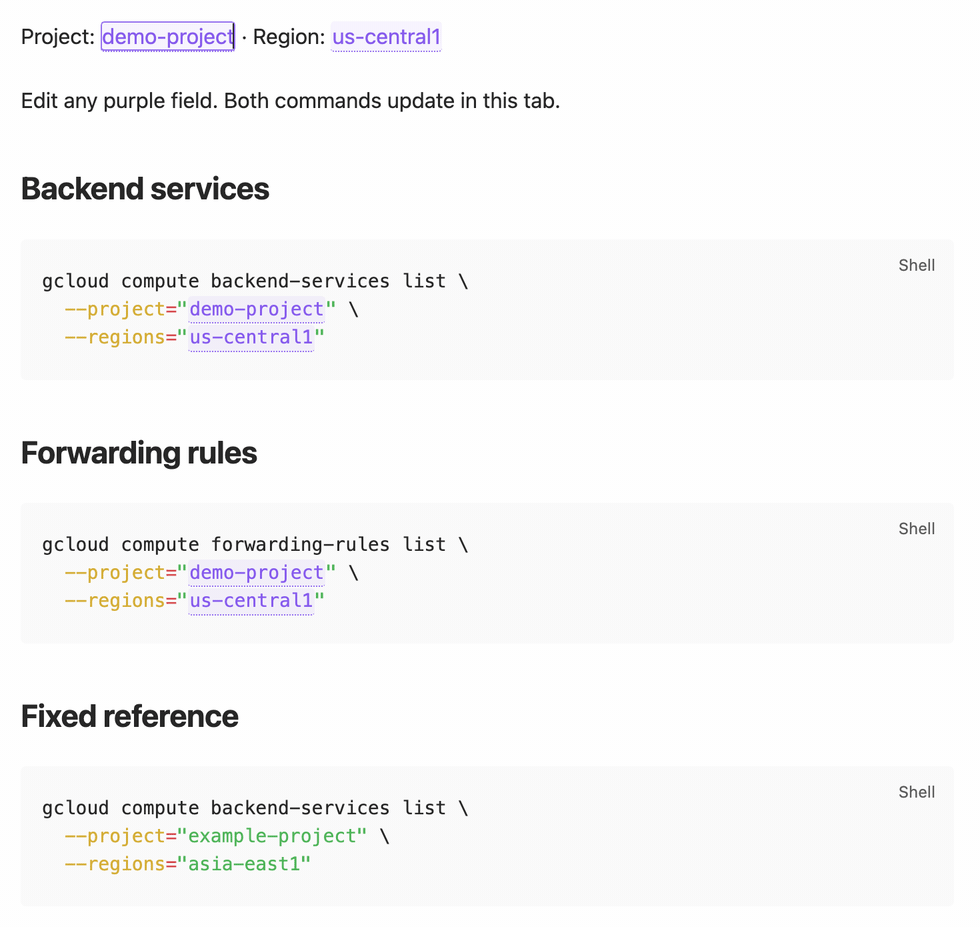
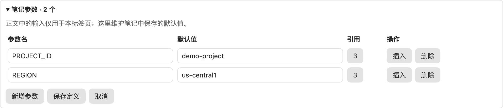

# Live Note Parameters

**Write a reusable runbook. Fill in the context once. Copy commands with the values you need now.**

Editable parameters for Obsidian notes: click a value in prose or a command, and every matching reference in the current tab updates. Keep fixed examples beside the interactive version. Saved defaults stay in Markdown; temporary input stays in memory.

[中文说明](README.zh-CN.md) · [Quick start](#try-a-complete-note) · [Examples](#example-notebooks) · [Install](#install)

## See it in action



The loop shows three captured states in real Obsidian Live Preview: defaults, a new project, then a new region. The **Fixed reference** block stays unchanged. [Static Live Preview](docs/media/live-preview.png) · [Reading mode](docs/media/reading-mode.png) · [Demo source](examples/cloud-runbook.md).

With `PROJECT_ID` set to `atlas-staging` and `REGION` set to `europe-west1`, the code-block copy button produces:

```bash
gcloud compute backend-services list \
  --project="atlas-staging" \
  --regions="europe-west1"
```

This is the resolved command text, not command output. The plugin does not run it.

## What you can do

- **Fill anywhere, reuse throughout the tab.** Edit the same parameter in prose, inline code or an opted-in command block, in Live Preview or Reading.
- **Keep syntax and examples together.** Add `docvars` to interactive fences; ordinary fenced examples retain their literal text.
- **Copy the current command.** Reuse native code-block copy buttons, with current values and the original surrounding quotes.
- **Start fresh in another tab.** Temporary values stay in that tab's memory; a fresh tab starts with saved defaults.
- **Maintain defaults while editing.** Use a collapsible panel for names, defaults, references and undoable saves.

## Try a complete note

After [installation](#install), paste this into a new note and use **Live Preview** or **Reading**. If the note already has frontmatter, merge `doc_vars` into its existing header.

````markdown
---
doc_vars:
  PROJECT_ID: "demo-project"
  REGION: "us-central1"
---

Project: {{PROJECT_ID}} · Region: {{REGION}}

Inline command: `gcloud --project="{{PROJECT_ID}}"`

## Editable syntax

```bash docvars
gcloud compute backend-services list \
  --project="{{PROJECT_ID}}" \
  --regions="{{REGION}}"
```

## Fixed example

```bash
gcloud compute backend-services list \
  --project="example-project" \
  --regions="asia-east1"
```
````

1. Click any purple parameter and enter a value. Matching fields in this tab update immediately.
2. Use the command block's existing copy button to copy the resolved command.
3. Open the same note in a fresh tab to start from `demo-project` / `us-central1` again.

| Part | Meaning |
| --- | --- |
| `doc_vars` | Note-level saved defaults, as a YAML mapping of strings |
| `{{PROJECT_ID}}` | A named reference in prose or inline code |
| `bash docvars` | A command block that opts in to editable references |
| Plain `bash` | A literal block, suitable for fixed examples |

## Example notebooks

All examples contain synthetic values. Open their Markdown source to copy a complete note, or read the [walkthroughs and resolved commands](docs/examples.md) without installing anything.

| Scenario | Fill in | Reuse |
| --- | --- | --- |
| [Cloud runbook](examples/cloud-runbook.md) | Project and region | Backend-service and forwarding-rule commands share the same context |
| [Kubernetes checks](examples/kubernetes-checks.md) | Context, namespace and app label | Pod and event queries use the selected namespace |
| [HTTP request notebook](examples/http-request.md) | Base URL, resource ID and request ID | An inline endpoint and a `curl` command share the same values |

## Install

Desktop MVP. Requires Obsidian 1.13.7 or newer; validated on macOS with 1.13.7.

1. Download `main.js`, `manifest.json` and `styles.css` from [Releases](https://github.com/nestealin/obsidian-live-note-parameters/releases).
2. Place them in `<vault>/<config-dir>/plugins/live-note-parameters/` (the default config directory is `.obsidian`).
3. Reload Obsidian's community plugin list and enable **Live Note Parameters**.

For in-app installation, check the [official community listing](https://community.obsidian.md/plugins/live-note-parameters). If **Add to Obsidian** is unavailable, use the manual steps above. BRAT users can add `nestealin/obsidian-live-note-parameters`.

## Use

In **Live Preview** or **Reading**, click an underlined parameter to type. Other occurrences in the same tab update immediately. Empty input is an explicit empty value; press `Esc` to restore that parameter's default. The **重置当前标签页变量 (Reset current tab parameters)** command clears all overrides.

Switching between modes retains the current tab's values. A fresh tab starts at defaults. Source mode shows the original placeholders.

Existing code-block copy buttons copy the resolved values. With **Copy Inline Code 2.1.0** installed, its existing inline copy icon also copies resolved values. Clicking a parameter edits it; clicking the copy icon copies the entire inline snippet. Ordinary inline copying stays with the existing plugin. Without that optional plugin, this plugin does not add inline copy icons.

Parameters are substituted literally. Add the appropriate quoting for the command or format you are writing; this plugin does not perform shell escaping or execute copied commands.

## Maintain defaults in Live Preview

Expand **笔记参数 / Note parameters** above the editor, or use the note toolbar's sliders icon / **管理笔记参数 (Manage note parameters)** command.



The panel edits **saved defaults**. The purple fields in the note edit **temporary values for this tab**. In this example the panel can keep `demo-project` while the current tab uses `atlas-staging`.

- Add parameters, edit names/defaults, inspect reference counts, locate or insert references.
- Edits remain a draft until **Save definitions**. **Cancel** discards the draft.
- Renaming previews the affected reference count and updates eligible references in the same editor transaction. Fixed example blocks remain untouched.
- A referenced parameter cannot be deleted. Resolve its references first.
- Saving updates only the definition range and explicitly renamed references; unrelated frontmatter/body stay intact. One native undo restores the definition edit.
- Existing tab overrides are retained when defaults change. Untouched parameters and new tabs use the new defaults.
- A stale definition draft is rejected. Renames also reject changes to the body made since the draft started.

Legacy `<!-- doc-vars {...} -->` declarations render during transition. **Preview migration** shows the new frontmatter before explicitly applying one undoable edit that removes the old comment. Declaring both formats is an error; there is no hidden precedence.

## Configuration and common questions

| Question | Answer |
| --- | --- |
| Can I keep my existing frontmatter? | Yes. Add one `doc_vars` mapping alongside `title`, `tags` and other properties. The manager preserves unrelated metadata and body text. |
| Do I have to edit YAML every time? | No. Use purple fields for the current session, or the Live Preview manager to save new defaults. Obsidian's native Properties view may show the nested mapping as JSON; use the manager or source mode to maintain it. |
| Which names and values work? | Names start with a letter or underscore, then use letters, digits or underscores. Reserved names `__proto__`, `prototype` and `constructor` are rejected. Values are single-line strings of at most 512 characters. Quote dates, numbers, booleans and empty strings in YAML. |
| Does it support expressions or nested definitions? | No expressions, nested values, YAML anchors or aliases inside `doc_vars`. References are substituted literally. |
| What happens with an empty field? | It becomes an explicit empty value. Press `Esc` to restore that parameter's default; use **重置当前标签页变量 (Reset current tab parameters)** to reset all. |
| Why do I still see `{{NAME}}`? | Check the spelling and default definition, use Live Preview or Reading, and add `docvars` to the fence. Source mode intentionally shows placeholders. Definition errors appear in the Live Preview manager. |
| Does inline code have its own copy button? | This plugin adds no inline copy icons. With optional **Copy Inline Code 2.1.0**, its existing icon copies the whole inline snippet with resolved values. |
| Will changing a field modify the note? | Only saving definitions changes Markdown. Temporary field input is not saved. Switching modes retains it in the same tab; a fresh tab starts at defaults. |

## Data and compatibility

Temporary values belong to the current tab and stay in memory. They are not written to notes, plugin data, browser storage or workspace state. Defaults are ordinary note metadata. Copying writes to the system clipboard only after a copy action.

No network requests, telemetry, command execution or template evaluation. Rendering accesses only the opened note; protected private paths are skipped. Disabling the plugin restores readable Markdown placeholders.

MVP scope: desktop, the main application window, prose, inline code and ordinary top-level fenced blocks. Mobile, pop-out windows, transclusions, complex nested Markdown, all themes and all code-block plugin combinations have not been accepted. The minimum version reflects the tested renderer.

## Project maintenance

Use Node 22+ and the committed dependency lockfile. Keep `package.json`, `manifest.json`, `versions.json` and the changelog consistent. Product documentation describes supported features, observable behavior, usage constraints and maintenance procedures.

```sh
npm ci --ignore-scripts
npm test
npm run build
npm run check
```

Before releases and after host upgrades, verify dual-mode input, definition edits and Undo/Redo, copy buttons, adjacent quotes and tab isolation. Install the same verified assets in test and user vaults. [Maintenance and verification](docs/maintenance.md) covers packaging, acceptance, upgrades and rollback. [CHANGELOG](CHANGELOG.md) records released behavior.

Example notes and their resolved walkthroughs are maintained together. [Demo media maintenance](docs/media/README.md) explains how to refresh the real screenshots and animation. Report reproducible issues with your Obsidian version, display mode, copy-plugin version and a small sanitized example through [GitHub Issues](https://github.com/nestealin/obsidian-live-note-parameters/issues).

## License

MIT. See [LICENSE](LICENSE) and [third-party notices](THIRD_PARTY_NOTICES.md).
